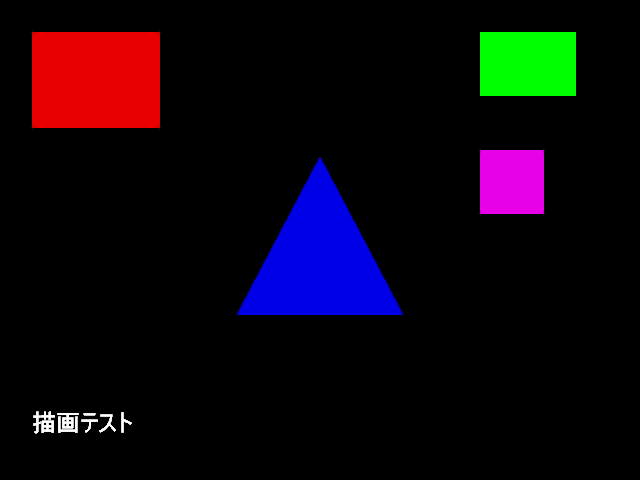
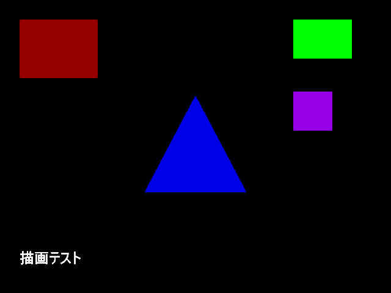
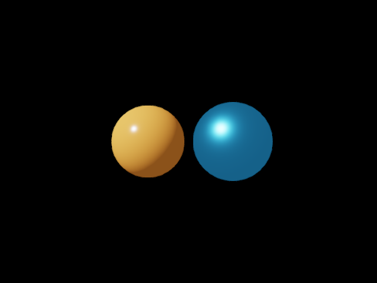
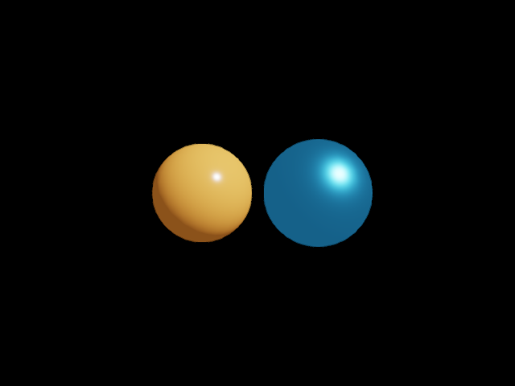
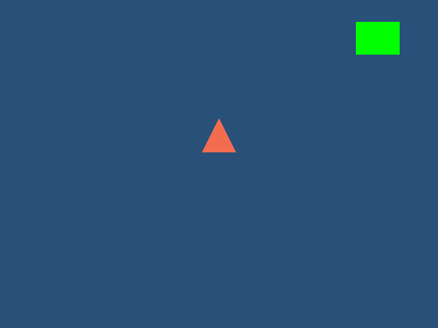
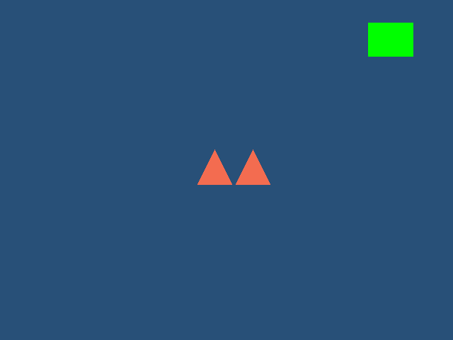
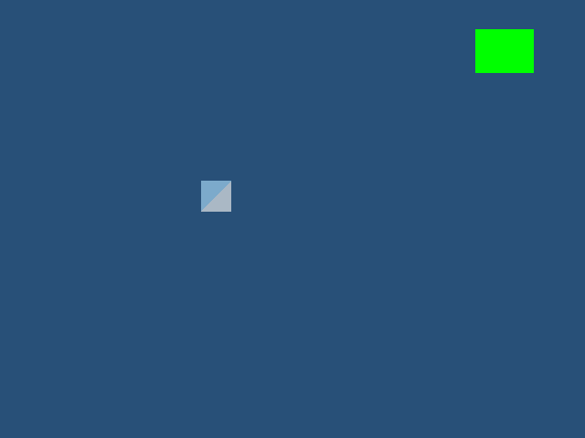

# GPUで確認した描画

Windows 11 Pro、RTX 4070 SUPER / driver 610.74で取得した実際の描画画像です。ReleaseとDebug RuntimeはVisual Studio 2026 / v142、Windows SDK 10.0.22621.0でビルドしました。画像は最終描画先から読み戻した640×480のRGBデータを、色を変えずにPNGへ保存しています。

## 基本描画とポストエフェクト

赤いScene矩形、青い3D三角形、マゼンタのPNG画像、緑のUI矩形、日本語文字を同時に描きます。通常設定とFXAAを無効にした設定の両方で、各図形の内部の色と位置、文字領域の白画素を検査します。



独自のtint処理でSceneの赤成分を下げると、矩形とPNG画像の色が変わります。処理後に重ねるUIの緑は同じ値を保ちます。テストではSceneの変化量とUIの一致を別々に判定します。



## 同じアプリ内での効果切り替え

2026-10-07に、同じアプリで6回のPresentを行い、ポスト効果を無効・有効へ交互に切り替えて各フレームを取得しました。Scene矩形の赤成分は232、149を交互に示し、UI矩形はすべてのフレームでRGB `(0, 255, 0)`を保ちました。毎回、3D・PNG画像・日本語文字の表示も判定しています。

取得枚数は開発テスト専用の設定で1〜16枚を指定でき、省略時は従来どおり1枚です。追加画像は`sequence.ppm.frame1.ppm`から連番で保存します。0、17、数値でない設定は診断付きで失敗し、画像を生成しないことを検査しています。

## Debug RuntimeとD3D12 InfoQueue

Debug構成では`_DEBUG`からThe Forgeの`FORGE_DEBUG`、`ENABLE_GRAPHICS_VALIDATION`が有効になります。Debug画像テストの13箇所で`ID3D12InfoQueue`取得成功を確認しました。固定したAgility SDKの`d3d12SDKLayers.dll`をDebug出力先へ配置しない初回はInfoQueueが取得できず、必須確認を追加したテストがPresentで失敗しました。DLLをDebug構成へstageした後は取得でき、全CTest 34/34が成功しました。Debug構成だけではInfoQueue取得を保証しません。

GPU-based validationは有効化していません。ReleaseとDebugで同一GPU・driverから取得した通常描画、direct、tint、sequence 6枚、model 2枚の計11枚のPPMはbyte単位で一致しました。この比較は画像の再現性を示し、画質の合否を示すものではありません。

## モデルの色と照明

`examples/assets/model_lighting.glb`の2球を使います。左は暖色の非金属、右は寒色の金属です。画像を持たない材質には、1×1の白い2D画像を使って材質の色を保ちます。



方向光を90度回すと、明るい側と反射の位置が変わります。左右の領域に十分な有色画素があることと、方向変更によって画素が変わることを検査します。



## 多数の描画を進めた後の確認

毎フレーム1024枚の全画面矩形を重ね、3D三角形とUIを含む描画を123フレーム続けます。通常の描画処理を119フレーム進め、フレーム119と120だけを読み戻します。両画像でSceneの青・赤の切り替え、3Dの水色、UIの緑、日本語文字を検査しています。早いフレームから画像取得のためにGPUを待つ経路は追加しません。

この確認は描画順とフレーム更新の回帰検査です。GPUの使用率、目標FPS、全フレームのちらつきや画質を測る試験ではありません。出力画像は`build/runtime-windows/frame-stress/Release`に保存します。

## 効果ごとの比較

露出・トーンマッピング・彩度・コントラスト・Bloom・FXAAを1つずつ変えた11設定と、フレーム開始後の設定変更を確認する3枚を追加しています。効果は色・明暗・にじみ・輪郭の変化で判定し、不透明なUI矩形と文字背景の領域は全設定で同じ画像を保ちました。Release/Debugの計14画像はbyte単位で一致しています。実際の画像と数値は[ポストエフェクト](effects.md)を参照してください。

## 透明UIと画像の寿命

赤い画像を青い不透明なUI背景に重ね、4段階のalpha、alphaBlend無効、1×1画像の拡大と90度回転を確認しました。Sceneに強い効果を適用しても検査対象のUI領域は同一でした。描画を登録してから画像handleを削除し、Presentまで画素が残ることと、古いhandleが拒否されることも確認しています。

画像を132フレームにわたって読み直してcacheの128枠を超えた後でも、末尾2フレームのUI画素が基準画像と一致しました。Release/Debugの取得4画像も一致しました。実画像と使い方は[画像の描画](images.md)を参照してください。

## 独自シェーダーの定数と画像

定数slot 0と63でScene/UIの矩形を色付けし、描画命令を登録した後の定数変更が既存命令へ影響しないことを確認しました。2種類のPNGを各層へ描き、4象限の内部画素で画像指定とUV座標を検査しています。画像を指定しない描画は、白い代替画像と描画命令の色を使えました。

6フレームの値の更新、使用中shaderの削除拒否、Present後の削除と削除済みhandleの拒否も確認しました。Release/Debugで取得した6画像は構成間で一致しました。実画像と使い方は[カスタムシェーダー](custom-shader.md)を参照してください。

## GLB材質のUVセット

基本色画像が指定するUV0・UV1・UV2と、指定を省略したモデル、正規化した8bit・16bitのUV1を使うモデルの計6種類を確認しました。同じ形状のUV0とUV1で画像が左右に切り替わり、45,000画素が異なりました。指定省略はUV0と、UV2と正規化整数のUV1は浮動小数のUV1と全画素一致しました。背景と不透明なUI領域も保持されました。

Release/Debugの6画像は構成間でbyte単位に一致しています。実画像と読み込み条件は[モデルガイド](models.md)を参照してください。モデルには環境光1・方向光0、ポスト処理は無効の設定を使うため、材質の照明品質を評価する結果ではありません。

## GLBモデルのアルファ抜き

アルファ値0・64・128・255の赤いPNGと材質のアルファ係数を使い、OPAQUEとMASKの描画を比較しました。MASKは画像と材質のアルファを掛けた値が境界値未満の画素を描かず、境界値と等しい画素は残します。0・1・1超の境界値、画像なしの材質も含め、Scene11画像とUI4画像を確認しています。

深度の検査では、MASKモデルを描いた後に、同じ画面範囲の青い面をモデルより奥へ描きました。切り抜いた領域だけに青い面が見え、残った赤い領域は青い面に隠されませんでした。抜いた画素が深度を更新しないことを確認する1画像です。実画像と再検査手順は[モデルガイド](models.md)を参照してください。

## 金属度・粗さの画像

画像のGを粗さ、Bを金属度として線形で読み、材質係数との積を照明へ使います。画像を読むモデルと、対応する数値係数だけを持つ参照モデルを描き、実際の画素を比較しました。shaderの照明式をテスト側へ再実装して期待色に使ってはいません。

Scene15・UI8画像で、R/Aの無視、係数の乗算、同じ画像を基本色と材質に使う場合の別色空間、基本色と独立したUV、同じ基本色に異なる材質画像を使う描画を確認しました。追加の132フレームでは共有画像を毎回読み直し、sRGBと線形の2資源を作ってからモデルをPresent前に削除します。264資源が128枠を超えた後のフレーム130・131も参照画像と一致しました。byte上限、GPU性能、全フレームの画質を測った結果ではありません。

25画像はRelease/Debug間でbyte単位に一致しています。画像と使用条件は[モデルガイド](models.md)を参照してください。

## GLBの法線画像

明示NORMAL/TANGENTを持つGLBで、線形RGBから接線方向の法線を読みます。単色normalをRGBA `(192, 192, 255, 255)`、方向光を `(0.7, 0.4, 1)`・強さ2、環境光を0.1に固定し、標準ポスト処理は無効、露出・彩度・コントラストは1で比較します。照明式をテストへ複製せず、対応する頂点法線を持つモデルを参照にしています。

Scene17枚、UI8枚、描画時の負scale2枚、共有画像を132回読み直した後のframe 130・131の2枚を確認しました。alphaの無視、scaleの0・2・負値、接線の符号、独立したUV1、同じtexture indexの基本色/MR/法線への指定、nodeと描画時の鏡映を扱います。対照のnormalなしモデルとは45,000画素がRGB差10超（最大13）、参照との比較は差2以下です。UIの緑領域とScene背景も保持されました。

接線Wを意図的に使わないshaderで鏡映モデルを描く負例は45,000画素・最大18の差で失敗しました。正規shaderへ復元した後、Release/Debugの29画像が構成間でbyte単位に一致しました。最後の2frameは画像取得のためGPUを待つため、132frame全体の性能やちらつきを評価した結果ではありません。

別texture indexが同じimageを参照するGLB、MRと法線だけが同じimageを参照するGLB、PNG内容は同じでもimage項目が別のGLBを、Scene/UIで参照モデルと比較しました。追加6画像は全画素一致しています。画像共有はモデル内だけで、役割ごとのUV・色形式を保ちます。

同じ画像への3参照を持つGLBを50回読み、同じ位置へ重ねて1frameに描画を登録し、全handleをPresent前に削除する追加ケースも確認しました。旧実装は150のGPU資源を要求して128 entryのcache上限で失敗しました。共有後はsRGB/線形の2形式をモデルごとに使って100資源となり、同じケースでPresentが成功し、参照と全画素一致しました。alias GLBの132回再読込後2画像も参照と一致しています。最終取得画像は合計38枚で、Release/Debug間で全画像がbyte単位に一致しています。

実画像、読み込み条件、再検査コマンドは[モデルガイド](models.md#glb-の法線マップ)を参照してください。内部の頂点は160byte、公開カスタムshaderの入力は従来のままです。他GPUは未検証の範囲です。

## GLBのsamplerと拡大・縮小

基本色・MR・法線の画像は別々のsamplerで参照します。範囲外UV `(-0.25, 1.75)` と4象限の画像を使い、REPEAT・MIRRORED_REPEAT・CLAMP_TO_EDGE、U/Vの別指定、省略時のREPEAT、正負の整数端を参照色と比較しました。同じ画像に2つのsamplerを指定した材質を左右に描くScene/UI検査は、参照と全モデル領域一致しました。

同じ画像を基本色/MR/法線に使い、各役割にClamp/Repeat/Mirrorを指定したScene/UIのPBR検査も追加しています。参照は選択される基本色・材質係数・頂点法線から作り、照明式をテストへ複製していません。RGBの差は最大1でした。

拡大・縮小はNEARESTとLINEARを互いに反対に指定し、別々に選択されることを確認しました。拡大はモデル領域が参照と一致、縮小の中心画素はNEAREST `(128,64,255)`、LINEAR `(125,118,255)` で参照と一致しました。samplerのLOD上限が0の初回は、縮小指定が拡大設定で処理されて失敗しました。LOD上限を広げ、画像の1段だけを使う設定で修正しています。ミップマップの生成や縮小時の画質を評価する検査ではありません。

同じ画像を異なるsamplerで使うGLBを132回読み直し、各frameでPresent前にモデルを削除しました。フレーム130・131の画像は参照と一致し、物理画像とsampler別descriptorのcache入れ替えを確認しています。取得は合計34画像で、Release/Debug間でbyte単位に一致しています。実画像と対応範囲は[モデルガイド](models.md#glbのsampler設定)を参照してください。

## GLBのミップ生成

64×64の縞模様を1画素あたり約4.76 texelへ縮小し、4種類のminFilterを個別に比較しました。選択段2と3の間を25%補間する条件を使い、画素間Nearest/Linearと段間Nearest/Linearの差を別々に要求します。中心RGBは9984で0、9985で137、9986で100（参照99）、9987で152となりました。

sRGB画像はRGBを線形光へ直して平均し、アルファは線形で平均します。MRと法線の画像は線形値で平均し、法線はshaderがsample後に正規化します。共有画像の3役割、MR、normalは最終段が選ばれる条件で参照と比較し、同じUVのミップなし反例とも比べました。中心RGBの最大差はそれぞれ52、33、75で、用途別のミップ処理を無視すると失敗します。照明式をテストへ再実装して期待値には使っていません。

奇数サイズの5×3と1×7では最後の1画素だけを白くし、最終段に端の画素が含まれることを確認しました。中心RGBは73と106で参照と一致しました。CPUでは3×3、5×3、1×5、5×1の面積平均、全段配置、色空間、入力保持、確保途中の失敗時の出力保持も確認しています。

同じ画像をミップなし/ありの2材質で描くGLBを132回読み直し、Present前にhandleを削除しました。frame130・131の左右の検査画素は参照と一致しました。cacheは色形式とミップ構成が同じ画像を共有し、異なる構成は分けて保持します。物理画像の128枠とdescriptorの128枠を越えた後の寿命・転送確認です。論理RGBA byte上限256MiBにはstagingの整列やCPU一時領域を含めていません。

取得した28画像はRelease/Debug間でbyte単位に一致しました。この検査は指定画素と設定差、最終段の平均値を確認します。連続移動でのちらつき、あらゆる画像の縮小画質、GPU性能を測ったものではありません。実画像と設定の使い方は[モデルガイド](models.md#glbのミップマップ)を参照してください。

## GLBの自己発光

emissiveFactorとsRGBのemissiveTexture、KHR_materials_emissive_strengthを反射光へ加えます。画像alphaは使わず、独立UV・sampler・ミップを保持します。画像なしの白と係数の既定値の黒を使い、強度は省略時1です。

Windows 11 Pro build26200、RTX 4070 SUPER / driver610.74、VS2026 / v142 14.29.30133（MSVC19.29.30159）、Windows SDK10.0.22621.0、CMake4.3.1でReleaseとDebugを確認しました。ambient=0・方向光=0の発光色は、ambient1で基本色を描く独立参照と全画素一致しました。画像A=0でもRGB `(204,102,51)` を表示し、sRGB128の画像は最終RGB128になりました。MASKの左側は背景 `(40,80,120)`、右側は発光色 `(64,160,224)` と一致しました。

同じimageをRepeat/Clampで使う隣接材質は左 `(128,64,192)`、右 `(32,160,224)` と参照に一致し、sampler設定を共有した誤りを検出します。同じ画像・samplerで係数と強度だけを変える材質も比較しました。ミップあり/なしの反例では44,820画素に10を超える差、最大188を検出しました。132回の再読込とPresent前のhandle削除の後、frame130/131は参照と全画素一致しました。

HDR強度4を露出0.25で描き、Bloom on/offの両方をambient4の基本色参照と全画素比較しました。双方とも一致し、Bloom有無では48,260画素に10を超える差、最大179がありました。内蔵モデルのScene/UI描画、四種類のtextureとsampler、色係数、アルファの切り抜き、寿命を確認する検査です。取得した45画像はRelease/Debug間でbyte単位に一致し、Sceneの参照差は最大1、UIは差0でした。実画像と使い方は[モデルガイド](models.md#glbの自己発光)を参照してください。

自己発光は周囲のモデルを照らす機能ではありません。全面画像の画質、動的なちらつき、GPU性能、他GPU、GPU-based validation、device loss復旧は、この追加検査の対象外です。

## GLBの環境遮蔽画像

occlusionTextureの線形Rをstrengthで調整し、一様環境光だけへ適用します。GBAはこの効果へ使わず、方向光と自己発光は保ちます。画像なしやstrength0では従来の明るさを維持します。

Windows 11 Pro build26200、RTX 4070 SUPER / driver610.74、VS2026 / v142 14.29.30133（MSVC19.29.30159）、SDK10.0.22621.0、CMake4.3.1でRelease/Debugを確認しました。全CTestは各60/60、43画像と判定JSONは両構成で完全一致し、Scene/UIとも全画面の参照比較で差0でした。baseColor0.8にR0/128/255を適用した中心RGBは `(0,0,0)` / `(170,170,170)` / `(231,231,231)` でした。線形RをsRGBとして読んだ場合や、GBAを効果へ混ぜた場合は参照と一致しません。同じimageのRepeat/Clamp材質はRGB124/170、同じimage・samplerのstrength0/1はRGB231/124になり、材質ごとの設定差も要求しています。

UV1と画像共有、ミップ指定と未指定、MASKのアルファ切り抜き、Scene/UIを比較しました。ミップ有無は44,820画素に10を超える差、最大170があり、同じ平均値に偶然揃った画像の比較にはしていません。MASKの透明側は背景 `(40,80,120)`、残す側は遮蔽後の灰色 `(170,170,170)` です。検査用の基本色画像はClamp/Nearestを指定し、AO画像は既定Repeat/Linearを保っています。

方向光だけ・自己発光だけの設定で、遮蔽画像R0と画像なしの材質を全画素比較し、明るさが変わらないことを確認しました。混合照明では同じ基本色・方向光・自己発光を使い、実材質のambient1とAO0/strength.5を、画像なしのambient.5へ比較して一致しました。反射式をテスト側へ複製せずに、環境光だけが減衰することを検査しています。

132回の再読込と各Present前のhandle削除の後、frame130/131は参照と全画素一致しました。物理画像128枠を越える再読込と、退避時の関連descriptorの無効化・再登録を確認します。利用者向けの指定例と実画像は[モデルガイド](models.md#glbの環境遮蔽画像)にまとめています。画像を自動生成するAOや動的な影、全面画質、性能、他GPUを確認したものではありません。

## GLBの接線自動生成

normalTextureがあり、TANGENTを省略したprimitiveは、明示NORMALと法線画像のUVから接線を生成します。明示接線は従来のまま使います。計算はnode変換前に行い、後から位置・法線・接線を変換して鏡映の符号を反映します。

平面、UVの鏡映・回転、UV1、共有辺の接線不連続、非indexed mesh、非一様node変換、tiny node、未参照頂点を含む11対を、解析的な接線を明示したGLBへ比較しました。Sceneの全640×480、UIの2対、描画時の鏡映、132回再読込とPresent前のhandle削除後frame130/131は参照と全画素一致しました。接線生成以外の材質・画像・照明は共通にし、normal-mapを外した反例では45,000画素に10を超える差、最大24を確認しました。

生成順を確認するモデルは、共有辺の2面の角度が等しく、sourceの接線が `(1,1,0)/sqrt(2)` になる形です。非一様scale `(2,1,1)` の後は `(2,1,0)/sqrt(5)` が正しい参照になります。変換後に平均すると角度重みが変わるため、その接線を持つ有効なGLBも反例として描きました。正しい生成との比較は3,462画素に2を超える差、最大11を検出しました。単なる実装同士の同一結果比較ではなく、独立な幾何と誤順序の画像で感度を確認しています。

CPUではcornerごとの方向・Wの符号と他のUV保持、必要な頂点分割、面順序不変性、未参照頂点の除外、零面積・零UV面積の拒否、上限、メモリ確保失敗時の出力保持を確認します。MikkTSpace source/headerは固定commitの原文を保持し、内部割当もfoundationを通します。source/headerはSDKに入れず、noticeを必須ファイルとして配布物検査へ加えました。

Windows 11 Pro build26200、RTX 4070 SUPER / driver610.74、VS2026/v142 14.29.30133（MSVC19.29.30159）、SDK10.0.22621.0、CMake4.3.1で確認しました。Runtime全CTestはRelease/Debug各60/60成功、32画像と判定JSONも両構成で完全一致しました。実画像と指定の条件は[モデルガイド](models.md#接線を省略したglb)を参照してください。アニメーションやスキニング、全面画質、FPS、他GPU、device loss復旧は今回の確認範囲外です。公開カスタムshader ABIと内部頂点160byteは変更していません。

## GLBの面法線生成

NORMALを省略したGLBは、sourceの三角形の巻き方向から面法線を求めます。同一平面は頂点を再利用し、鋭い辺は各面の向きを保つため頂点を分けます。法線がない場合は入力TANGENTを無視し、法線画像を使う場合だけ生成した法線から接線を計算します。明示NORMALを平均・再生成する変更はありません。

12組のモデルを、解析的な面法線と接線を明示した参照へ比較しました。平面、UV1、鋭い辺、共有平面、非indexed、非一様node変換・回転・鏡映、tiny node、未参照頂点、法線画像の有無を含みます。Sceneは全640×480、UIは3組、描画時の鏡映と再読込後frame130/131も参照と一致しました。初回focused ReleaseのGPUは46.26秒で成功しました。全Runtime CTestはRelease/Debug各60/60成功し、取得35画像と判定JSONも両構成で完全一致しました。

鋭い辺を平均法線で描いた有効なGLBを反例として比較し、618画素でRGB差2超、最大4を検出しました。normal-map無しの反例では45,000画素に10を超える差、最大24がありました。法線の向きと接線の利用が結果へ反映されることを、同じ生成実装で作った参照に頼らず確認しています。

CPUでは三角形法線、鋭い辺の分割、巻き方向と面順序、全画像UV保持、TANGENTのクリア、未参照NaN頂点、極端な1e30/1e-30座標、退化面、空・範囲外index、頂点上限不足、確保失敗時の出力保持を確認します。法線生成なしの既存接線モデルで、未参照零法線を新しい検査が拒否する回帰も検出・修正しました。生成なしの明示法線・no-mapでの特異node処理は従来のまま、生成法線で変換できない特異nodeは読み込みを拒否します。

条件と実画像は[モデルガイド](models.md#法線を省略したglb)を参照してください。アニメーション、全面画質、FPS、他GPU、device loss復旧はこの追加検証の対象外です。公開カスタムshader ABIと内部頂点160byteは変更していません。

## 再実行

```bat
PRE_SETUP.bat --gpu-check
```

Debug構成では次を実行します。

```bat
PRE_SETUP.bat --configuration Debug --gpu-check
```

ビルド済みの環境で画像テストだけを実行する場合は、次を使います。

画像取得用のRuntimeはウィンドウを非表示にして描画し、フォーカスを移さず検査します。通常のRuntime DLLにはこの非表示設定を含めません。画面を開く`gkcore.backend_smoke`とSDK consumerのGPU実行は、CMakeの`GKCORE_RUN_INTERACTIVE_TESTS`を明示的にONにしたときだけCTestから実行します。既定値はOFFです。SDK consumerのビルド・リンクと配布内容の検査はOFFでも実行します。

```bat
ctest --test-dir build/runtime-windows -C Release -R gkcore.render_capture --output-on-failure
```

PPM画像と判定値のJSONはReleaseでは`build/runtime-windows/render-captures/Release`、Debugでは`build/runtime-windows-debug/render-captures/Debug`へ出力します。Debug実行に必要な`d3d12SDKLayers.dll`はDebug構成の出力にだけstageします。インストール済みSDKの検査では、通常のRuntime DLLを使う別アプリをビルドし、初期化・描画・最初のPresent・終了を確認します。

この検査は代表画素と領域の条件を使います。全面画像の画質、連続フレームすべてのちらつき、PBRの物理的な正確さを判定するテストではありません。公開サンプルは起動して表示を確認し、mixed_sceneでは最大化後の表示も確認しました。輪郭サンプルではSpaceによるBloomのON→OFF→ONと短いEscape入力による終了を確認しました。全キーを実画面から操作する検査、モデル照明サンプルのキー操作、GPU-based validation、他のGPU、全モデル形式の描画は未確認です。Runtime DebugのInfoQueueと画像検査は確認済みです。

実装上の原因と修正前後の記録は[TDD検証ログ](TDD_LOG.md)、対応機能と残作業は[機能とサポート状況](ROADMAP.md)を参照してください。

## モデル変換と透明部分の回帰検査

`gkcore.model_blend_capture`はOPAQUE・MASK・BLEND、同じモデル内の透明三角形、モデル間の奥行き、Scene/UI、camera変更、2D描画との境界を画像で検査します。GPUでのモデル変換には3軸回転、負の非一様scale、off-axis camera、方向光を使い、位置・法線を独立に事前変換したGLBへ比較します。透明モデルの登録順を逆にしても画像が変わらないことも確認します。

2026-10-09のRelease検査は19.26秒で成功しました。変換後のOpaque画像は参照と最大channel差1、BLEND参照・逆提出順は全画素一致しました。変換を外した反例では37,477画素に差12超を検出しています。追加した変換検査も最終統合検査でDebug/Releaseとも成功しました。

## 2026-10-08〜09 モデルアニメーション

OBJ連番・GLB・FBXのアニメーション、2clipブレンド、初期morph姿勢、外部clipの解放後適用、同一frameの異なる姿勢とmodel削除後の描画、IKをNVIDIA RTX 4070 SUPERで検査しました。独立した静的形状/モデル変換を参照にし、SourceのDeformを期待値の生成に使っていません。

12組と、132frame連続描画のframe130/131は最大RGB差0でした。静止との変化は1319〜4422画素、連続frame間は1655画素です。単にcaptureが繰り返し一致するだけでなく、指定した時刻・IK目標の形状に一致し、実際に動いていることを確認しています。







PNGはPPMのRGBを変更せず保存し、decode後も全画素一致しました。基本形状を使う機能検査であり、人型モデルの外観品質・全面画質・FPS・他GPUの確認ではありません。操作と入力条件は[モデルアニメーション](model-animation.md)を参照してください。

最新のRuntimeはRelease/Debug各78/78のCTestが成功し、SDKだけのconsumerも実行できました。DebugではD3D12 InfoQueueの取得を確認し、GPU-based validationは有効にしていません。CPU各53件とnativeの描画・animation・packageを両構成で再検査しています。実行ログはbuild/native-validation/model-animation-*、画像と結果JSONは各Runtime buildのmodel-animation-capturesにあります。

## 2026-10-09 実モデルのGPU変形

YUMEKAとSilly Dancing・Capoeiraのブレンドを6姿勢で取得しました。Debug/Releaseとも、各姿勢の45,233位置・55,747法線をCPU参照へ比較し、位置の最大差0、法線の最大差約0.000000179で成功しています。許容値0.0005は変更していません。複数model、退化した法線、float overflowと大きい有限値の対照検査も成功しました。

native全体はDebug78/78件（571.96秒）、Release78/78件（509.18秒）、CPUは各53/53件成功しました。実行ログは`build/native-validation/final-native-debug-tests.log`と`final-native-release-confirm-tests.log`、実モデルは`final-yumeka-{debug,release}-capture.log`です。画像は`build/real-model-captures/{Debug,Release}/final-yumeka-blend*.ppm`へ保存しています。通常Runtimeでの表示速度は[モデルviewerの処理時間](model-performance.md)を参照してください。

## Mixamoの脚ボーン対応

以前の自動推定は`UpLeg`を太ももと認識せず、その子の`Leg`もすねへ割り当てていませんでした。その状態のGPU/CPU一致は、motionの全身が正しく転送された証拠ではありません。実際の骨名と階層を使った回帰テストを追加し、描画前に左右の太もも・すね・足首・つま先の8役割を必須確認する`GKCORE_TEST_REQUIRE_HUMANOID_LEGS=1`も検証用captureへ追加しました。

修正後のYUMEKAはSilly Dancing・Capoeiraのそれぞれと51本が対応します。単独再生2種類とブレンドを各6姿勢、Debug/Releaseで取得し、18画像が構成間で全画素一致しました。各姿勢の全45,233位置・55,747法線はCPU参照へ比較して位置差0・法線最大差約0.000000179です。画像は`build/real-model-captures/{Debug,Release}/mixamo-legs/`、ログは`build/native-validation/mixamo-legs-{debug,release}-{silly,capoeira,blend}.log`にあります。

この脚対応修正後のCPU全体はDebug/Release各53件、nativeの対応推定・binding・API・animation画像・BLEND画像・SDK consumerを含む関連9件が両構成で成功しました（Release95.15秒、Debug108.19秒）。native全78件の記録はGPU変形追加時点の結果です。脚修正後のログは`mixamo-legs-native-{debug,release}-tests.log`です。


## 揺れものの侵入点を詳しく調べる

検証用captureへ`GKCORE_VERIFY_SKIN_POINTS=Skirt`と`GKCORE_SKIN_POINT_DETAIL_FRAME=81`を指定すると、そのframeで最大32件の侵入点を深さ順に出します。`gkcore_model_skin_point_detail`が件数と参照元、`gkcore_model_skin_point`がmesh所属、身体shape、weight内訳と対応する骨球を記録します。`bodyShapeAncestor`はshape取付boneとその骨格祖先へのweightで、身体meshに対応するweight分類ではありません。元の参照一致検査は全frameで続き、詳細診断の失敗は別のJSONへ出します。通常DLL/SDKにはこのtoolやtest exportを含めません。

`GKCORE_SKIN_POINT_DETAIL_PENETRATIONS=1`では、選択したskin点のうち身体形状へ侵入した点だけを全frameで記録します。`gkcore_model_skin_penetration_frame`は位置ID、mesh名、最も深い身体形状番号、描画と同じ位置、侵入深さを含み、`positionSource`は`rendered skin`です。既存のframe指定詳細が使う`pre-contact sparse skin`とは区別してください。この出力は`GKCORE_SKIN_POINT_MESH_SUMMARY`なしでも有効で、点選択・描画・接触判定を変更しません。対象外の頂点やtriangle内部の交差は調べません。

点位置は補正前のsparse skin、sphere位置は現在の描画FK、身体は直近Updateのshape snapshotです。頂点補正はOFFの状態で調べます。今回のloop frame81では30点が侵入し、最深は`Yumeka_Cos_Skirt`のposition31877/local28、UpperLeg_L capsuleへ深さ.03001297でした。Skirt_3_L.002/Skirt_4_L.002へ約68%/32%で、腰などのweightはありません。対応sphereからはそれぞれ.03696/.09170離れています。これは小球が実skin面を覆いきれないcaseで、骨の接触成立だけから布の非侵入を導けません。記録は`build/native-validation/secondary-skin-detail-frame81.json`です。

## 複数鎖を結ぶ接触線分

検証用の侵入点JSONへ、skirt骨球の中心、各weightの変換後寄与位置、最深body shapeの端点を追加しました。frame81の最深点は骨原点間線分から.052388 model unit離れ、半径.038の外です。skin寄与位置2点も身体形状内で、約68%/32%の合成位置を誤差3.154e-9で再構成しました。骨球だけで布面の非貫通を保証できない根拠です。

別鎖の自由bone原点を半径付き接触線分で結び、単一接続/10本輪状接続を0秒・3.35秒開始、Debug/Release各120frameで確認しました。Win11 build26200 / RTX4070SUPER driver617.42 / v14219.29 / SDK22621.0。合計960GPU frameがCPU位置/法線参照と一致し、構成間48画像がbyte一致。接続OFFの240frameも成功し、旧実装24画像がbyte一致しました。輪状接続のloop最大侵入深さは.030013→.020639、平均点数16.517→15.833で、侵入は残ります。

拡大画像はbuild/native-validation/secondary-links-quality-{none,ring,debug}.png、切抜きは同名-crop.pngです。2560×1920・3.35秒開始・frame81を接続なし/輪状/形状表示で比較し、PNG保存後のpixel一致を確認しました。後ろ側や他motion、skin面全体の品質を合格とする結果ではありません。生のPPMは保存一致を記録後に片づけます。詳細はsecondary-links-image-comparison.json、secondary-links-off-image-comparison.json、bone-link-coverage-analysis.jsonです。

## 接続準備の共有前後を比較する

YUMEKA＋Silly Dancing/Capoeira blend＋右腕IK＋13鎖＋8身体形状＋輪状10接続、半径.038、頂点補正OFFの設定を保持して、接続端点と同半径の身体形状を各Update内で共有しました。Win11 build26200 / RTX4070SUPER driver617.42 / v14219.29 / SDK22621.0で0秒・3.35秒開始を各120frame、Debug/Releaseで順番に実行し、480frameのGPU位置/法線と全Skirt点の参照一致を確認しました。

24姿勢の両構成48画像は旧実装とbyte一致し、構成間24組も一致しました。接続OFFのRelease120frame/12画像も従来と一致しています。最大位置差9.314e-10、normal1.789e-7、loopの侵入点平均15.833/最大深さ.020639 model unitを保持しました。見た目や侵入を改善する変更ではありません。記録はbuild/native-validation/link-cache-image-comparison.json、link-cache-off-image-comparison.jsonです。

## substep内の共有と実時間再生

YUMEKAの接続10本設定を保持して、目標方向/長さと接触形状の準備をsubstep内で共有しました。Win11 build26200 / RTX4070SUPER driver617.42 / v14219.29 / SDK22621.0でDebug/Release各2区間×120frame、計480frameのGPU位置/法線とSkirt点を確認。旧版と全480skin JSON・48画像が一致し、構成間24組もbyte一致。接続OFFのRelease120frame/12画像も一致しました。最大位置差9.314e-10、normal1.789e-7。画質・侵入を改善する変更ではありません。

可視計測の1回はwarmup中に接触検査で失敗しました。そのdeltaを保存できておらず、元の失敗は未再現です。benchmarkだけにGKCORE_BENCHMARK_DELTA_TRACE_PATH/GKCORE_BENCHMARK_DELTA_REPLAY_PATHを追加し、更新間隔を再生します。診断modeではFPS値を出しません。実測3300frameと変動1200frameを変更前HEADのsolver/collision DLLと現在版で各4500frame再生し、双方が完走しました。これを元の失敗の修正完了とは扱いません。比較と実機ログはreference-cache-image-comparison.json、reference-cache-off-image-comparison.json、constraint-delta-{trace-1,jitter}-{replay,legacy}.logです。

## 接続候補と描画FKの許容幅

接続候補は許容幅の半分を姿勢変換の丸め用に残し、描画FKの最終許容幅は維持します。Win11 build26200 / RTX4070SUPER driver617.42 / v14219.29 / SDK22621.0、YUMEKA・Silly Dancing/Capoeira blend・右腕IK・13鎖・身体8形状・接続10本・頂点補正OFFで、0秒/3.35秒開始をDebug/Release各120frame、計480frame確認しました。GPU位置/法線とSkirt1314点の参照が全frame有効で、最大位置誤差9.314e-10、法線1.789e-7です。

構成間24組の画像と全skin記録が一致しました。変更前とは確定位置が少し変わり、48画像の差は640×480の24〜96pixelです。loop侵入平均15.833、最大深さ.020639は残ります。保存画像の目視でも面の非貫通や全motionの品質を合格とする結果ではありません。比較はlink-roundtrip-image-comparison.json、目視画像はlink-roundtrip-quality.pngです。

変更後の可視delta replay4500frame、実時間trace1200frame、通常計測3300frameは接触失敗なく完走しました。純poseの境界跨ぎは再現できましたが、以前のwarmup失敗の原因はまだ同定できていません。調査用build/scriptと重複画像は比較hashを残して片づけ、最新Releaseの24画像とdelta、失敗記録、比較PNGを保持します。

## 接続が成立した鎖への再計算を減らす

初回の制約検査後、投影で変わった鎖と不成立linkの両端鎖を復元対象にしました。Win11 build26200 / RTX4070SUPER driver617.42 / v14219.29 / SDK22621.0、YUMEKA・2motion blend・右腕IK・13鎖・身体8形状・接続10本・頂点補正OFFで、0秒/3.35秒開始をDebug/Release各120frame、計480frame確認しました。GPU位置/法線とSkirt1314点の参照は全frame有効、最大位置誤差9.314e-10、法線1.789e-7です。

構成間24組の画像と240件のskin記録は一致しました。変更前の48画像では34枚がbyte一致し、残る14枚の差は各1〜3pixel/640×480です。侵入点数は全frame同じで、深さ差は最大8.36e-8 model unitです。loop平均15.833/最大深さ.020639の侵入は残り、布面の品質改善とは扱いません。比較はconstraint-dirty-image-comparison.json、constraint-dirty-skin-config-comparison.json、目視画像はconstraint-dirty-quality.pngです。

可視benchmarkの変更前後は各3000frame/warmup300、変更後のdelta replayは実測3300＋変動1200frameが完走しました。以前のwarmup失敗の原因同定とは区別します。元assetと現在のbuild、最新Release画像、検証ログ、delta、失敗記録を保持し、調査用build/scriptと重複画像は片づけます。

## 半径別のstep形状を共有する

同じ接続更新内で、鎖の節半径ごとの拡張・guard・prepared形状を共有しました。Win11 build26200 / RTX4070SUPER driver617.42 / v14219.29 / SDK22621.0、YUMEKA・2motion blend・右腕IK・13鎖・身体8形状・接続10本・頂点補正OFFで、0秒/3.35秒開始をDebug/Release各120frame、計480frame検証しました。GPU位置/法線とSkirt1314点が全frame有効、最大位置誤差9.314e-10、法線1.789e-7です。

変更前の全480skin記録と48画像が一致し、Debug/Release間の24組もbyte一致。loop侵入平均15.833/最大深さ.020639も保持しており、画質改善とは扱いません。比較はstep-shapes-image-comparison.json、目視画像はstep-shapes-quality.pngです。実測delta3300frameの隠し再生と変動1200frameの可視再生も完走しました。最初の可視実測再生はAPIエラーなく295frameで途中終了し、step-shapes-trace-1-replay-incomplete.logへ分けています。


## 接触投影と骨長復元の停止を再現する

benchmarkのGKCORE_BENCHMARK_DELTA_TRACE_PATHは、全deltaを固定容量bufferへ保存して再生終了後にまとめて書きます。記録行は更新に渡す前に保持するため、失敗した更新のdeltaも含みます。以前の毎frame書き込みとfflushは次frameのdeltaに含まれ、失敗を再現しにくくしていました。再生中のファイル長が0、終了後に全行を保存し、traceWritten=trueを確認します。GKCORE_BENCHMARK_DELTA_REPLAY_PATHとは同時に使えません。記録・再生modeはFPS計測値に数えません。

constraint-buffer-green-deltas.txtの611個を使い、GKCORE_BENCHMARK_FRAMES=611、GKCORE_BENCHMARK_WARMUP=0、GKCORE_TEST_WINDOW_VISIBLE=0でbenchmarkを再生します。頂点接触OFF、YUMEKA・Silly DancingとCapoeira・blend+右腕IK・13鎖・身体8形状・接触線分10本・距離10組です。修正前は距離併用時だけ611番目で接続1と身体形状4が未収束になり、距離なしは完走します。GKCORE_TRACE_SECONDARY_CONSTRAINTS=1はcapture/testのbuildだけで、失敗した最後2反復の距離投影後・接触線分投影後・鎖復元後における距離残差と形状別の最大侵入をJSONへ出します。通常SDKに診断計算や出力は含めません。

修正後の611再生はDebug/Releaseともcompleted=trueで、通常の実時間3000frame/warmup300も距離あり・なしで完走しました。固定delta1/60の2区間×120frame×Debug/Release計480frameでGPU位置・法線・Skirt点参照を確認し、24画像組が一致しています。開始区間とloop区間の保存画像・Skirt記録は修正前と一致します。clothの非貫通を改善した結果ではありません。今回の停止は修正しましたが、deltaを保存しなかった以前のshape5/link8のwarmup停止まで同じ原因だったと断定しません。最新の失敗・再生・成功記録はconstraint-buffer-green-*.log、constraint-failure-replay-{on,off}.log、constraint-fixed-replay-{Release,Debug}.log、constraint-final-benchmark.log、constraint-off-benchmark.log、constraint-image-comparison.jsonです。
